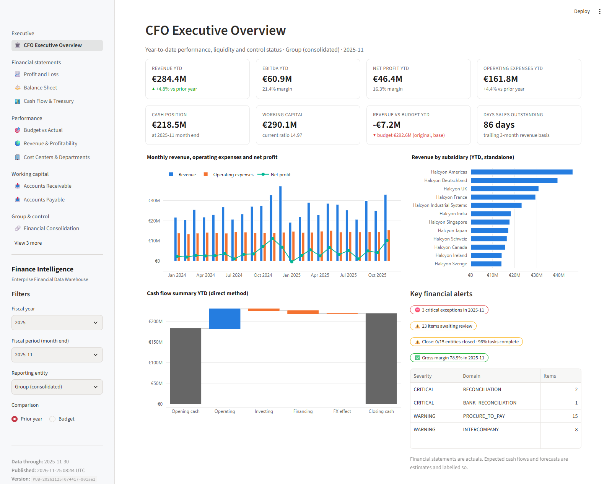
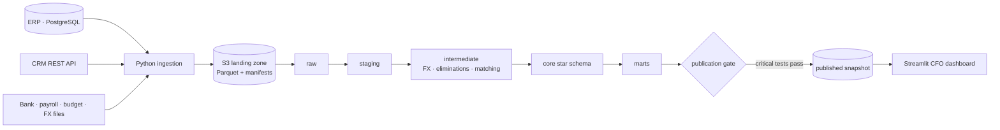
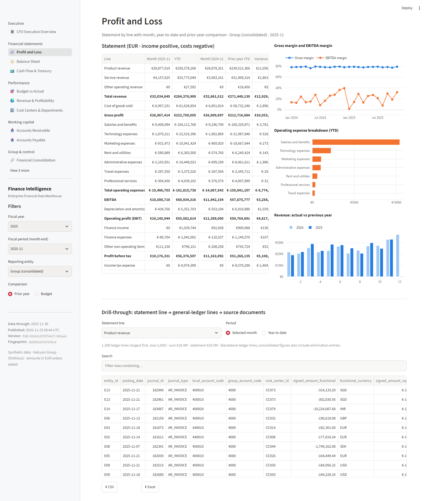
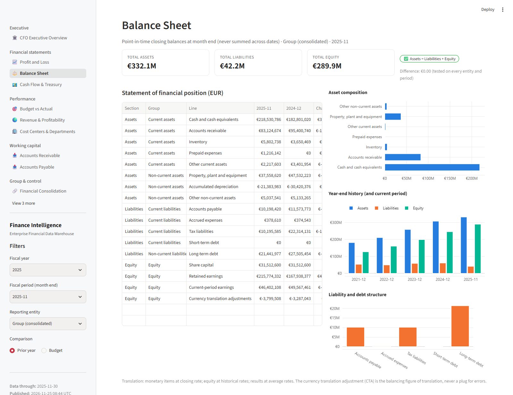
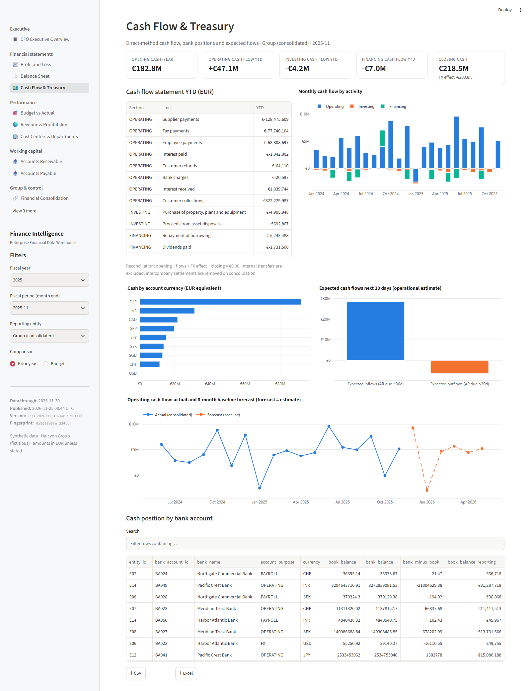
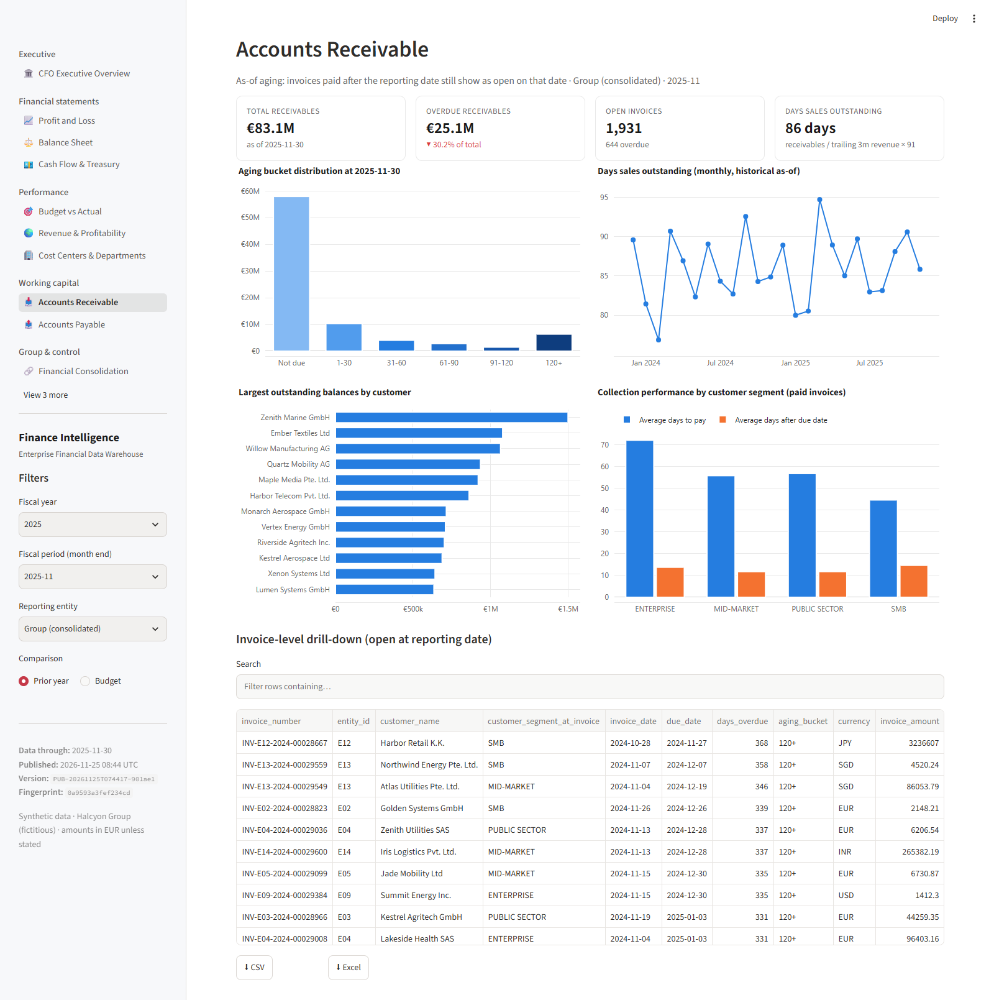
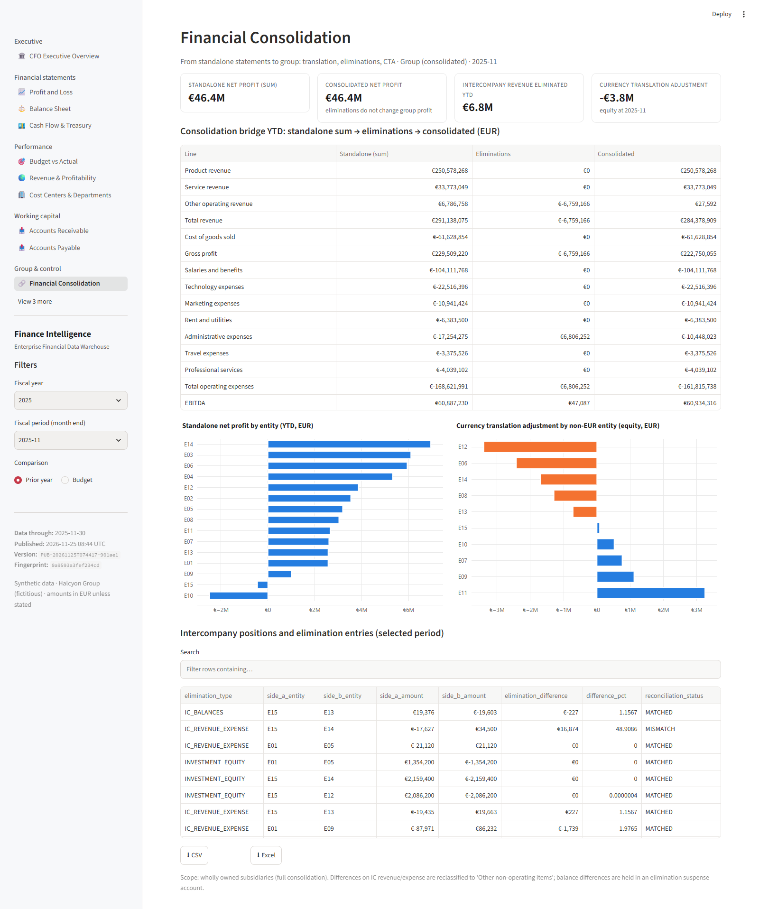
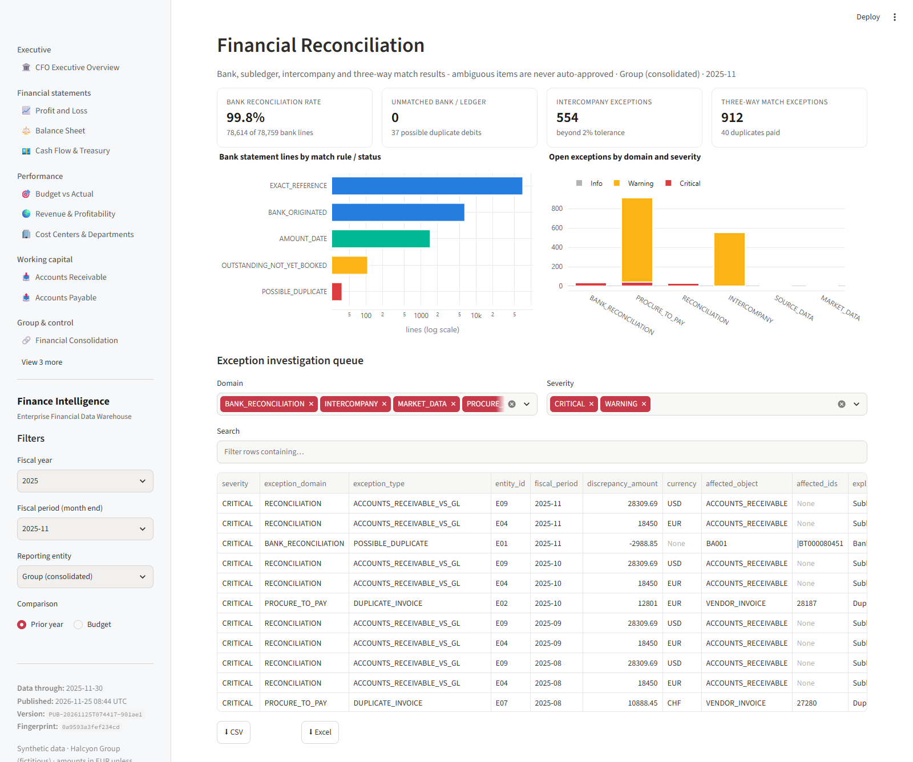

# Enterprise Financial Data Warehouse

An end-to-end financial data platform for a fictitious multinational, **Halcyon Group**: 15 legal entities
and 9 functional currencies, with five years of double-entry accounting. The source systems are simulated:
an ERP in PostgreSQL, a CRM REST API, and bank, payroll, budget and FX file drops. Data lands in an
S3-compatible zone and is loaded into a warehouse. There, dbt does currency translation, intercompany
eliminations, reconciliations and period close. Validated statements are published to a 13-page CFO
dashboard.

It runs entirely on a laptop (DuckDB + Docker) with no cloud account. The same dbt project targets
Snowflake. The Snowflake objects and the AWS infrastructure are provided as code but **not deployed**.



> All data is synthetic and generated deterministically (seed `20250101`). Companies, customers, suppliers,
> banks and people are fictitious. The data contains no real account numbers, card data or personal data.

## What it demonstrates

| Area | Highlights |
|---|---|
| **Accounting realism** | Every business event posts a balanced journal. Order-to-cash, procure-to-pay, payroll, fixed assets, intercompany, loans, VAT, income tax and treasury. Period calendar with soft/hard close and an audited reopen. |
| **Multi-currency and consolidation** | Translation at closing, historical and average rates, with CTA as the balancing figure. Three elimination types with mismatch handling. Group profit is preserved through consolidation (tested). |
| **Ingestion** | Incremental ERP extract (composite watermark + overlap), paginated API with retries, file ingestion with SHA-256 duplicate detection and row quarantine. Manifests make loading idempotent. |
| **Modelling** | dbt: 105 models, 202 tests, 1 snapshot. Kimball star schema with SCD2 customer, employee and vendor dimensions. Incremental general ledger. As-of AR/AP aging rebuilt from settlement events. |
| **Controls** | Bank reconciliation (3 rules, 5-day tolerance), three-way matching, subledger vs GL at every month end, exception mart. A **publication gate** blocks reports when a critical test fails. |
| **Detection of planted problems** | GL-only AR adjustments, duplicate supplier invoices, bank duplicate debits, intercompany cut-off differences, bad FX publications, corrupted file deliveries. End-to-end tests prove each one surfaces. |
| **Platform** | Airflow 3 DAGs scheduled on data assets. Snowflake RBAC, masking and row-access SQL. Terraform for S3, IAM and Snowflake. GitHub Actions CI. |

## Architecture



More detail: [docs/architecture.md](docs/architecture.md) · [financial logic and planted scenarios](docs/financial-scenarios.md) ·
[data contracts](docs/data-contracts.md) · [decision records](docs/adr/) · [implementation status](IMPLEMENTATION_PLAN.md)

## Quick start

Requirements: Python 3.12, Docker, about 5 GB of disk. On Linux or macOS, `make <target>` works as well.
On Windows, use `python scripts/pipeline.py <command>`.

```bash
python -m venv .venv && . .venv/bin/activate      # Windows: .venv\Scripts\activate
pip install -r requirements.txt
cp .env.example .env                                # local-only defaults, no secrets needed

python scripts/pipeline.py demo                     # up -> seed -> ingest -> load -> transform -> publish
python scripts/pipeline.py dashboard                # http://localhost:8501
python scripts/pipeline.py test                     # pytest: unit, financial, integration, end-to-end
```

| Command | What it does |
|---|---|
| `up` / `down` | Start or stop PostgreSQL (port 5434) and SeaweedFS S3 (port 9100) |
| `seed` | Generate data and publish it "as of" 2025-11-30 to the ERP, the CRM API and the file drop |
| `ingest` · `load` · `transform` · `publish` | The individual pipeline stages |
| `incremental` | Advance the sources to 2025-12-31 and run the pipeline again incrementally |
| `reset` | **Destructive**: deletes local pipeline state, and asks for confirmation |

## Dashboard

There are 13 pages. All of them read only the published snapshot, and every table exports to CSV or Excel.

| | |
|---|---|
|  |  |
| **Profit and loss**: statement, margins, drill-through to ledger lines | **Balance sheet**: assets = liabilities + equity checked for every entity and period |
|  |  |
| **Cash flow & treasury**: direct method, ties to the cash movement | **Accounts receivable**: historical as-of aging and DSO |
|  |  |
| **Consolidation**: standalone → eliminations → group | **Reconciliation**: bank, intercompany, subledger vs GL |

All 13 screenshots are in [`dashboards/screenshots/`](dashboards/screenshots/). They are captured by
`scripts/capture_screenshots.py`, which also fails if any page raises an error.

## Measured results

All figures were measured on one machine: Intel i7-10700 (8 cores / 16 threads), 32 GB RAM, Windows 11,
Python 3.12, `development` profile. **Snowflake performance and cost have not been measured.**

| Step | Volume | Time |
|---|---|---|
| Generate source data | 189,725 journals · 541,580 journal lines · 469,889 business-document versions | 42 s |
| Seed ERP (PostgreSQL) | 1,134,759 rows in 31 tables | 112 s |
| Ingest ERP (full) | 31 tables, 1,134,759 rows | 17 s |
| Ingest CRM API | 5 resources, 126,954 rows | 560 s |
| Ingest files | 3,709 files, 493,879 rows | 773 s |
| Load raw (DuckDB) | 44 manifests, 1,755,592 rows | 9 s |
| `dbt build` | 314 nodes: **311 pass, 1 warn, 0 error** | 34 s |

CRM and file ingestion are the bottleneck: one HTTP page and one file at a time, on purpose, to keep the
audit trail simple. Parallelising them is the obvious next optimisation.

Data-quality results from the same run:

* 0 unbalanced journals. The trial balance is zero for every entity and period. The balance-sheet
  equation holds everywhere.
* AP subledger = GL control account at every month end. The AR subledger differs **only** by the two
  planted GL-only adjustments. That difference is the one dbt warning, kept visible on purpose.
* Bank reconciliation: 78,614 of 78,759 bank lines matched (99.8%). The rest are the planted bank
  duplicates (37) and fees not yet booked at the cut-off (108).
* Forecast backtest, 6 monthly origins (WAPE): revenue 0.097, operating expenses 0.030, operating cash flow
  0.758. The baseline (growth-adjusted seasonal naive) is not useful for cash flow, which is lumpy because of
  tax and dividend payments. The dashboard labels every forecast as an estimate.

## Testing and CI

| Suite | Count | What it covers |
|---|---|---|
| `tests/unit` | 16 | Money rounding, FX conversion, allocation, ledger invariants |
| `tests/financial` | 11 | Generator output: balanced journals, subledger/GL ties, closed periods |
| `tests/integration` | 8 | Built warehouse: trial balance, balance-sheet equation, consolidation, AP tie, bank match rate |
| `tests/end_to_end` | 6 | Planted scenarios are detected, raw reload is a no-op, published fingerprint matches |
| dbt tests | 202 | Schema, relationship, accounting and reconciliation tests (some tagged `critical` for the gate) |

Locally all 41 pytest tests pass with none skipped. Warehouse-backed tests **skip** (and say so) when no
warehouse has been built. A skip never counts as a pass.

CI ([`.github/workflows/ci.yml`](.github/workflows/ci.yml)) runs ruff, mypy, sqlfluff, the unit and
financial tests, the full pipeline on the `small` profile against real PostgreSQL and S3 services,
Terraform validation, Airflow DAG import checks, gitleaks plus pip-audit, and a Docker build. The Snowflake
compile job reports **SKIPPED** when no credentials are configured. *The workflow has not run on GitHub yet.*
Each step was run locally (Terraform and Airflow inside their official Docker images).

## Implementation status

| Component | Status |
|---|---|
| Generator, source systems, ingestion, raw load, dbt (DuckDB), publication gate, dashboard | **Implemented and tested** locally |
| Airflow DAGs (21) | Implemented. Import-validated in `apache/airflow:3.1.5`, not run on a scheduler |
| Terraform (S3, IAM, Snowflake) | Implemented. `fmt` / `init` / `validate` pass. **Never planned or applied** |
| Snowflake SQL (RBAC, masking, row access, stages, monitors) | Written. **Not executed** against an account |
| dbt on Snowflake | Project is adapter-aware. **Not compiled against a real account** |
| Power BI | Model specification and DAX measures only ([dashboards/powerbi](dashboards/powerbi/)). No PBIX |
| Prometheus / Grafana monitoring | Not implemented. Pipeline observability is in `finance_audit` and the Data Quality page |

Known limitations are listed in [IMPLEMENTATION_PLAN.md](IMPLEMENTATION_PLAN.md#known-limitations).

## Repository layout

```
config/                 financial rules, local settings, source configuration
data_generator/         deterministic double-entry generator (one module per business process)
source_systems/         ERP seeding (PostgreSQL), CRM REST API, file publisher
finance_common/         money/FX helpers, data contracts, object storage
ingestion/              database, API and file extractors + ingestion state
warehouse/local/        raw loader (DuckDB)      warehouse/snowflake/   Snowflake SQL (not executed)
dbt_finance/            dbt project: staging → intermediate → core → marts, tests, snapshot
dashboards/streamlit/   CFO dashboard            dashboards/powerbi/    model spec + DAX
orchestration/dags/     Airflow 3 DAGs           infrastructure/        Docker, Terraform
sql/                    stand-alone analysis and reconciliation queries
scripts/                pipeline runner, publication gate, generators for staging and docs, screenshots
tests/                  unit · financial · integration · end_to_end
docs/                   architecture, financial logic, data contracts, ADRs
```

## Licence

MIT. See [LICENSE](LICENSE).
