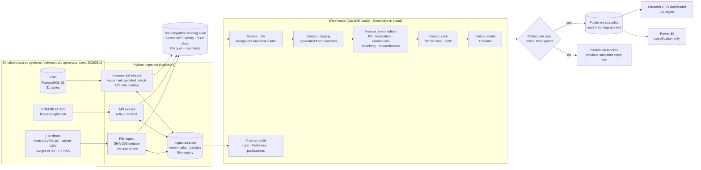
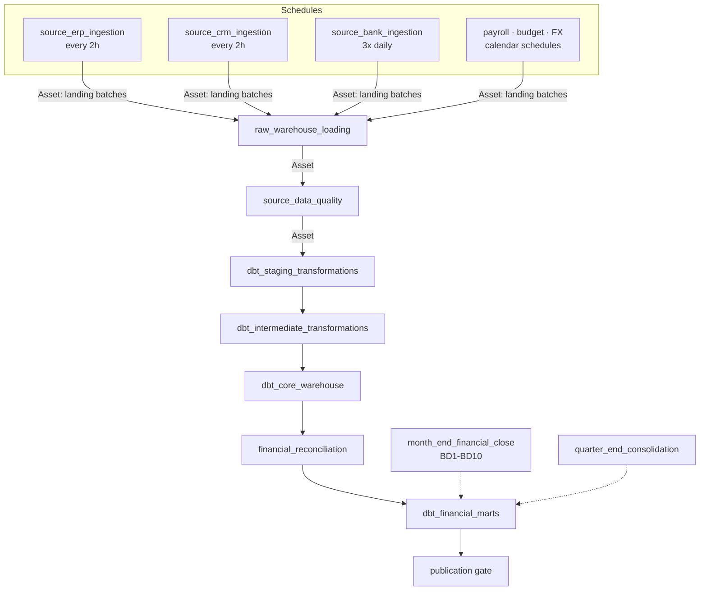

# Architecture

## Data flow

## Layers

| Layer | Schema | What happens there |
|---|---|---|
| Landing | S3 `landing/` | Immutable Parquet batches + a JSON manifest per batch (row count, checksum, watermark range). Rejected rows go to `quarantine/`. |
| Raw | `finance_raw` | One table per source table, loaded once per manifest (checksum verified, `raw_load_history`). Re-running is a no-op. |
| Staging | `finance_staging` | Generated from the data contracts: typing, renaming, latest-version dedupe, ingestion lineage columns. |
| Intermediate | `finance_intermediate` | Business logic: FX rate selection, account mapping, trial balance, currency translation, intercompany matching and eliminations, bank and three-way matching, subledger reconciliation, settlement events for as-of aging. |
| Core | `finance_core` | Kimball star schema. SCD2: `dim_customer` (CRM history), `dim_employee` (job history), `dim_vendor` (dbt snapshot). `fact_general_ledger` is incremental (delete+insert on DuckDB, merge on Snowflake, 45-day lookback for late postings). |
| Marts | `finance_marts` | Statements (P&L, balance sheet, cash flow, trial balance), working capital, budget, forecast, revenue, departments, reconciliations, exceptions, close status, executive summary. |
| Audit | `finance_audit` | Ingestion runs, source freshness, dbt results, publication history. |

The schema names are the same in DuckDB and Snowflake. Date functions go through adapter-dispatched macros,
so the same dbt project compiles for both (`--target snowflake`).

## Orchestration (Airflow 3, `orchestration/dags`)

21 DAGs, scheduled by data assets (Airflow 3 `Asset`) rather than fixed times. They are checked by
`orchestration/validate_dags.py` inside the official `apache/airflow:3.1.5-python3.12` image. All 21 import
without errors. The DAGs have **not** been run in a long-lived Airflow deployment. The local demo uses
`scripts/pipeline.py`, which runs the same commands in the same order.

## Cloud target (not deployed)

* **Snowflake**: SQL in `warehouse/snowflake/` (warehouses + resource monitor, database/schemas, RBAC with
  9 functional roles, masking and row-access policies, storage integration and stages, monitoring
  queries). **Not executed** against an account.
* **Terraform** (`infrastructure/terraform`): S3 data lake (versioned, encrypted, lifecycle rules), IAM
  roles for the pipeline and the Snowflake storage integration, and the Snowflake platform objects.
  `terraform fmt -check`, `init -backend=false` and `validate` pass. **`plan`/`apply` have never been run**,
  so nothing has been created and no cost has been incurred.
